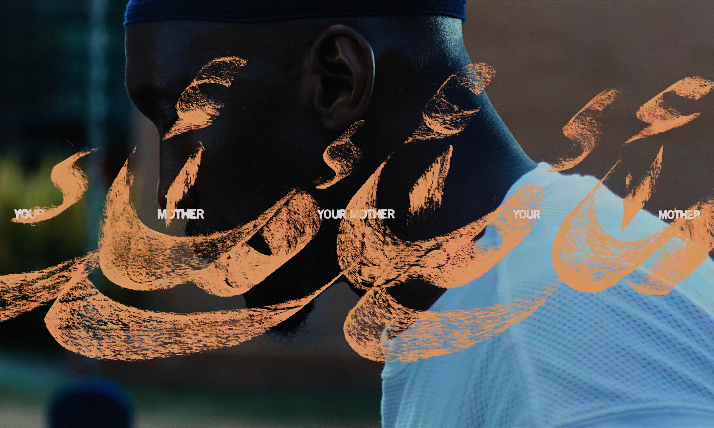

شاهدت أخيرا فلم (أمك ثم أمك ثم أمك) الجديد من بطولة الفنان ماهرشالا علي بعد ترقب طال. فلم درامي جميل مشبع بمشاهد أكشن دموية، وتفيض منه موسيقى ساحرة، يتحدث عن قاتل مأجور أمريكي مسلم يحاول رعاية عائلته بعد وفاة زوجه فجأة. الفلم لا يتحرج من التعرض لبعض الموضوعات الحساسة المتعلقة بالدين، مثل النفاق والتقصير في العبادة بل الشك في جدواها حتى، وغربة التدين، والمقاطع الإباحية وفتش الرموز الدينية. لا تملك نفسك إلا أن تنقبض أمام بعض تلك المشاهد ومما تفعل بعض الشخصيات وتقول. الفلم يعرض لك الحقيقة كما هي من دون تزييف أو تزيين، الواقع المر الذي تحاول أن تصرف عنه نظرك. وعرض الحقيقة من أغراض الفن في عمومه، ولكن لا أظنني كنت مستعدا لمواجهتها بتلك الفجاجة. قد أشاهده مرة ثانية. 